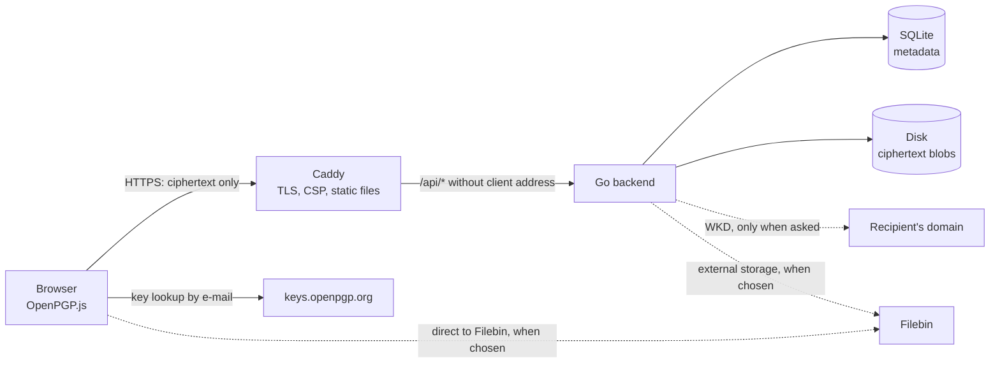

# Architecture

## Overview

| Component | Role |
|---|---|
| Browser | Encrypts and decrypts with OpenPGP.js (phase 2). Passwords and private keys never leave it |
| Caddy | TLS, security headers, serves the frontend, proxies `/api/*`. No access log; forwarding headers stripped |
| Go backend | Stores and serves ciphertext by random ID, enforces limits, removes expired files; optional WKD proxy (phase 3) |
| SQLite | One row per file: ID, hash of the delete token, size, created, expires, download limit and count |
| Disk | One file per upload in `data/blobs/<id>`, written via `data/tmp/` and an atomic rename |
| External storage | Optional (phase 5): ciphertext at a service such as Filebin instead of on disk, through the server or directly from the browser; see [External storage](#external-storage) |

## Encryption

All encryption happens in the browser with OpenPGP.js
(`frontend/src/lib/crypto.ts`). The output must open with GnuPG 2.4, which
does not support RFC 9580 (v6 packets, SEIPDv2/AEAD), so:

| Choice | Value | Why |
|---|---|---|
| Encryption packet | SEIPDv1 with MDC (`aeadProtect: false`) | Readable by every gpg version |
| Cipher | AES-256 | |
| Password S2K | Iterated and salted (no Argon2) | gpg 2.4 compatible |
| Compression | None | No compression oracle, simpler |
| Literal data | Text: format `u`, no file name. File: format `b` with the file name. Date always 0 | The name is encrypted, the server never sees it; no timestamp leaks |
| Recipient key IDs | Hidden (wildcard, like `gpg --throw-keyids`) | The server cannot link a message to a key on a keyserver |

Files are encrypted as a stream, so memory use does not grow with the file
size. Decryption checks the MDC over the whole message before anything is
shown, so the browser holds the ciphertext and plaintext of one file in
memory (fine at 100 MiB). A message without a file name is shown as text,
as with `echo … | gpg --encrypt`. Decrypted text is never rendered as HTML;
decrypted file names are stripped of directories and control characters.

`frontend/tests/gpg.test.ts` checks both directions against `gpg` with
the test keys in `testdata/keys` (CI requires gpg).

## Frontend

Svelte without a router library. Routes live in the URL fragment
(`#/d/<id>`, `#/delete/<id>/<token>`), so the same links work on the site
and in the single HTML file opened from `file://`, and the fragment (with
the delete token) is never sent to the server. The app is built as one
script and one stylesheet, without lazy-loaded chunks or workers, so
`make single` can inline everything into one file with a CSP by hash.

- **Send:** encrypt the stream, upload in one request if the ciphertext
  fits in one chunk (8 MiB), otherwise as a chunked upload with retries.
- **Download:** `HEAD` first, so opening the link (or a link preview bot)
  does not use up a download. After the user clicks, the ciphertext is
  downloaded once and kept in the page, so a wrong password can be retried.
  Text is shown as text, files are offered with `<a download>` from a
  `blob:` URL of type `application/octet-stream`.

## Public keys

In public-key mode the send page shows the chosen recipients in a frame
on top, and below it two tabs to add a key; once there is a recipient
the tabs fold away behind "Change key" and "Add another recipient".
Background information sits behind small ⓘ toggles (`
`, no
script). There are three ways to get a recipient's key
(`frontend/src/components/KeyPicker.svelte`,
`frontend/src/lib/keylookup.ts`):

1. **From your device:** choose a file (`.asc`, `.gpg`, `.pgp`, `.key`),
   drop it on the key field, or paste it. The key is read in the browser
   only and never sent anywhere.
2. **Look up by e-mail:** only when the user clicks "Look up key", the
   browser asks keys.openpgp.org
   (`GET /vks/v1/by-email/<address>`). keys.openpgp.org only publishes
   user IDs whose address it has verified.
3. **Also via WKD** (checkbox, off by default; hidden when the server has
   `FILEBUNNY_WKD_PROXY=false`): the backend fetches the key from the
   recipient's own domain (`POST /api/v1/wkd`, see `docs/api.md`). A
   browser cannot do this itself: the domains are arbitrary and cannot be
   listed in the CSP.

Enabled sources run in parallel, each with a 10 s timeout and a 1 MiB
cap, without cookies, referrer, cache or redirects. Every key is parsed
by OpenPGP.js in the browser; only keys with a valid (not revoked) user ID
for exactly the looked-up address that can encrypt are offered, and the
page lists what was dropped and why. Results are merged by fingerprint.
If the sources return different keys, or one source returns several, the
page shows a warning; it never picks a key itself. The user clicks "Use
this key"; every recipient shows its fingerprint (with a copy button) and
source.

**Recipients:** a new key (from a file, a drop, a paste or "Use this
key") replaces the current recipient, and the page says which one it
replaced, so a key added by mistake cannot silently stay: every key on
the list can open the message. Several recipients are still possible
through "Add another recipient"; the page then states that each of them
can open the one message with their own private key (one session key,
encrypted to every recipient, as `gpg -r a -r b`). A pasted key is read
as soon as the armored block is complete.

**Optional WKD check:** for any key on the recipient list (also one from
the device or a keyserver), "Check with the recipient's domain (WKD)"
fetches the WKD key for every address in its user IDs and compares
fingerprints: *matches*, *different key published* (warning), *no WKD key
published* (neutral: most domains publish none) or *check failed*. It is
never needed to send and never runs automatically.

keyserver.ubuntu.com is deliberately not used: it sends no CORS headers
on "not found", so a browser cannot tell a missing key from an outage,
and proxying it would show our server every looked-up address.

**Who sees what:**

| Way | Sees the looked-up address | Sees your IP address |
|---|---|---|
| From your device | Nobody | Nobody |
| keys.openpgp.org | keys.openpgp.org | keys.openpgp.org |
| WKD (lookup or check) | FileBunny's server (never logged or stored) and the recipient's domain | Only FileBunny's server; the recipient's domain sees the server's address |

**CSP:** `connect-src` is `'self'` plus exactly `https://keys.openpgp.org`
and, for the direct route to external storage, `https://filebin.net
https://storage.filebin.net` (in `deploy/Caddyfile` and in the single
HTML's CSP); no wildcard.

## Upload links

An upload link lets anyone send something that only its owner can open
(`frontend/src/pages/Receive.svelte`, `InboxUpload.svelte`,
`InboxManage.svelte`; `backend/internal/server/inbox.go`).

1. **The owner** picks a public key: a new key pair generated in the
   browser (see below) or an existing key (from the device or looked
   up). The browser sends the armored public key to
   `POST /api/v1/inboxes` and gets an ID and a management token. The
   page shows two links:
   - the **upload link** `#/u/<id>/<fingerprint>`, to give to senders;
   - the **management link** `#/m/<id>/<token>`, to keep.
2. **A sender** opens the upload link. The page fetches the key
   (`GET /api/v1/inboxes/{id}`) and **checks that its fingerprint equals
   the one in the link**; otherwise it refuses to send anything. So a
   server or database that swapped the key is caught, as long as the
   link reached the sender intact. Then it encrypts in the browser and
   uploads, in one request or chunked. The sender gets no ID or token.
3. **The owner** opens the management link: lists what arrived, unlocks
   the private key once in the page (never uploaded), opens items (text
   as text, files as downloads), saves them encrypted for gpg, deletes
   them, or revokes the link (stops uploads, deletes everything).

Files of a link are only served with the management token; the public
`/api/v1/files/{id}` routes never return them. Limits per link: uploads
(1–100, default 10), 100 MiB in total, open 1 day to 30 days (default
7); each file is kept 7 days after it arrived, also when the link closes
earlier. Counters are updated in the same transaction as the file row.

**Key pairs** (`#/key`, and inside the Receive page) are generated with
OpenPGP.js as Curve25519 in the v4 "legacy" format (EdDSA + ECDH): gpg
2.4 cannot import the RFC 9580 keys OpenPGP.js makes by default. The
private key always gets a passphrase, and the page only lets the user
go on after saving it (as an `.asc` file from a `blob:` URL) and
confirming. Name and e-mail are optional; without both the user ID is
"FileBunny key". With an e-mail address the public key can be published
on keys.openpgp.org (VKS API, directly from the browser), which then
mails a verification link.

## External storage

A share link's ciphertext can be kept at an external service instead of
on this server's disk (`backend/internal/storage`, step 3 on Send). For
now one service: [Filebin](storage/filebin.md). The owner of an upload
link can choose external storage too, through FileBunny only
(`inboxes.storage`): uploads to the link are sent on like share links, and
the owner's downloads are streamed back. The sender of a share link
chooses:

- **On FileBunny** (default).
- **Through FileBunny:** the server receives the ciphertext as usual
  (single or chunked), sends it on with its SHA-256 and drops its local
  copy. Downloads are fetched from the service and streamed; download
  limit, expiry and delete link work as for local files. The service sees
  only this server. The blob is named by a server-generated random
  reference; nothing from the client goes into a URL. When the file is
  deleted, expires or has its last download, the reference moves to a
  `remote_trash` table in the same transaction and is deleted at the
  service in the background (after the last download: right after the
  transfer, otherwise after an hour of grace for a running transfer),
  retried until it succeeds.
- **Directly:** the browser uploads to the service itself; the server
  knows nothing about the file. The link is `#/x/filebin/<bin>`, with the
  service's reference only in the fragment. No download limit or delete
  link; the service's own expiry applies, and it sees the sender's and
  recipients' IP addresses. If the browser cannot fetch the file (the
  service wants to check the browser first), the page sends the recipient
  to the service in a new tab and decrypts the saved file.

Each service gets a health check every 12 hours (a random 1 KiB blob:
upload, download, compare, delete) and is taken out of use after 3 failed
transfers in a row. While out of use, uploads there are refused with `503`
before any data is sent. Transfers are capped at 8 at a time per service,
15 minutes each, and a daily traffic cap for the whole server
(`FILEBUNNY_PROXY_DAILY_BYTES`). `GET /api/v1/storage` and `#/status` show
the state. Outgoing requests use their own client with the same address
checks as WKD, fixed hosts and at most one redirect between them.

## Request flow

**Upload** — `POST /api/v1/files`
1. Check `expires` (1 minute to 7 days), `max_downloads` (1 to 100) and
   `Content-Length` (≤ 100 MiB).
2. Reserve the size against the storage quota (`507` if full).
3. Stream the body to `data/tmp/upload-*`; each read must make progress
   within a minute.
4. `fsync`, generate ID and delete token, insert the row, rename the
   temp file to `data/blobs/<id>`.
5. Return ID, delete token and expiry.

**Chunked upload** — `POST /api/v1/uploads` opens a session (in memory,
max 50 server-wide) with a random ID and an upload token. Each `PUT`
appends one chunk (≤ 16 MiB) at the expected offset to a temp file and
reserves its size against the quota; a failed chunk is truncated away so
it can be retried. `POST …/complete` runs step 4 above. Sessions without a
request for 2 minutes are discarded, with their temp file and quota.

**Download** — `GET /api/v1/files/{id}`: validate the ID format, count the
download in one `UPDATE … RETURNING` that only matches a non-expired row
with downloads left (so concurrent downloads can never exceed the limit),
open the blob and stream it as an attachment. The last allowed download
removes the row and the blob right away; the open handle keeps streaming.
A download counts when it starts, also if the client aborts it. `HEAD`
returns the same headers (expiry, downloads left) without counting.

**Delete** — `DELETE /api/v1/files/{id}` with the delete token: compare the
token's hash in constant time, delete the row, then the blob.

**WKD lookup** — `POST /api/v1/wkd`: validate the address (strict
ASCII, no IP literals or ports), take one of 8 server-wide slots (`503`
if none), then fetch the advanced URL on `openpgpkey.<domain>`, and the
direct URL on `<domain>` only if that host does not exist. The dedicated
HTTP client (`internal/wkd`) speaks HTTPS to port 443 only, uses no proxy,
follows no redirects, verifies TLS, checks every resolved address and
again the address actually connected to (dialer `Control`, against DNS
rebinding) and refuses loopback, private, link-local, CGNAT, multicast,
reserved, documentation and IPv4-in-IPv6 ranges. 10 s and 1 MiB at most.
The key bytes go back unparsed.

**Cleanup** — every minute, delete rows and blobs whose expiry has passed.
At startup, also remove temp files and blobs without a row (left over
after a crash).

## What is stored

| Data | Where | How long |
|---|---|---|
| Ciphertext | `data/blobs/<id>`, or at the external service chosen | Until expiry (max 7 days, 6 at Filebin) or deletion |
| Storage name and reference at the external service | SQLite (`files`; `remote_trash` until it is deleted there) | Same as the file, plus until the service confirms the deletion |
| ID, size, created, expires, download limit and count | SQLite | Same, or until the last allowed download |
| SHA-256 of the delete token | SQLite | Same |
| Client IP address | Nowhere | — |
| Looked-up e-mail addresses (WKD) | Nowhere; in memory during the request only | — |
| Upload links: the owner's public key (incl. its user IDs), SHA-256 of the management token, expiry, limits and counters | SQLite | Until the link is revoked, or expired and empty |
| Files received by an upload link | `data/blobs/<id>`, row with `inbox_id`; or at the link's external storage, as above | 7 days after arrival (6 at Filebin), or until deleted or the link is revoked |
| Private keys and passphrases of generated key pairs | Nowhere (browser only) | — |
| File name, content type, plaintext | Nowhere (encrypted inside the ciphertext from phase 2) | — |
| Logs | Container stdout | No IPs, no IDs, no tokens; see below |

### Logs

- **Backend:** startup, shutdown, cleanup counts and server-side errors. Every
  message passes through `internal/logging`, which redacts anything that
  looks like an IP address. Handlers never log the client address, file
  IDs or tokens.
- **Caddy:** no access log. The error log (level `WARN`) has the client IP,
  headers and URI removed by a filter.
- `scripts/smoke-test.sh` checks both in CI.

## Threat model

### What FileBunny protects against

- **A curious or compromised server** reading your files: it only stores
  ciphertext. Without the password or private key it learns nothing about
  the content, file name or type (from phase 2).
- **Link leaks** revealing content: links never contain passwords or keys.
- **Server-side tracking** of who uploads or downloads: no IP addresses,
  no cookies, no trackers, no external scripts.

### What it does not protect against

- **Malicious JavaScript served by the server.** If filebunny.eu were
  compromised and served altered code, that code could read what you type.
  Mitigations: reproducible builds, signed releases, an external watcher
  and a downloadable single HTML file (phases 8 and 9).
- **Weak passwords.** In password mode, anyone with the link can try to
  guess the password offline.
- **Metadata visible to the server:** ciphertext size, upload and download
  times. Your IP address is visible to your network and to the hosting
  provider's infrastructure, even though FileBunny does not store it.
- **Compromised devices** of sender or recipient.
- **A wrong public key.** A keyserver or a domain can serve a key that is
  not the recipient's (keyserver.ubuntu.com-style servers accept any key
  for any address; keys.openpgp.org verifies the address, not the
  person; a domain can be compromised). The page warns when sources
  disagree and offers a WKD check, but only comparing the fingerprint with
  the recipient through another channel proves the key is theirs.
- **A swapped key behind an upload link** if the link itself was
  changed on its way to the sender: the fingerprint check only proves
  that the server sends the key the link names. Send upload links
  through a channel you trust.
- **The server knows whose upload link it is** when the key's user IDs
  contain a name or address. A generated key without them avoids that.
- **Lookups revealing who you write to.** keys.openpgp.org sees your IP
  address and the address you look up; with WKD on, FileBunny's server
  sees the address (not stored). Loading the key from your device avoids
  both.
- **External storage** you chose: the service can delete the file at any
  time, and with the direct route it sees your IP address and so does
  anyone who learns the link's bin name; that person can also delete it.
  It can never decrypt it.
- **Someone you gave the link to** sharing it further. Use public-key mode
  if only a specific person may read it.

## Limits and abuse

| Limit | Default | Setting |
|---|---|---|
| Max upload | 100 MiB (ciphertext) | `FILEBUNNY_MAX_SIZE` |
| Total storage | 20 GiB | `FILEBUNNY_MAX_TOTAL_SIZE` |
| Expiry | 24 h default, 1 min – 7 days | `FILEBUNNY_DEFAULT_EXPIRY`, `FILEBUNNY_MAX_EXPIRY` |
| Stalled transfer | 1 minute without progress | fixed |
| Open upload links | 1000 server-wide | `FILEBUNNY_MAX_INBOXES` |
| Per upload link | 10 uploads (max 100), 100 MiB, open 7 days (max 30) | `FILEBUNNY_INBOX_*` |
| WKD lookups in progress | 8 server-wide, 10 s and 1 MiB each | fixed; switch off with `FILEBUNNY_WKD_PROXY` |
| External storage | 8 transfers per service, 15 min each; 50 GiB of traffic per UTC day | fixed; `FILEBUNNY_PROXY_DAILY_BYTES`; off unless `FILEBUNNY_FILEBIN` |

Rate limiting, proof of work and abuse reporting follow in phase 7.

## Code layout

See [CLAUDE.md](../CLAUDE.md#layout).
