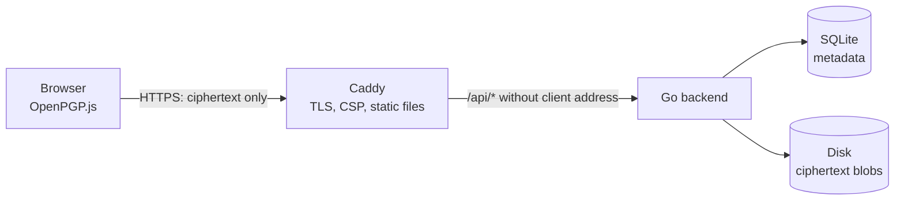

# Architecture

## Overview

| Component | Role |
|---|---|
| Browser | Encrypts and decrypts with OpenPGP.js (phase 2). Passwords and private keys never leave it |
| Caddy | TLS, security headers, serves the frontend, proxies `/api/*`. No access log; forwarding headers stripped |
| Go backend | Stores and serves ciphertext by random ID, enforces limits, removes expired files |
| SQLite | One row per file: ID, hash of the delete token, size, created, expires |
| Disk | One file per upload in `data/blobs/<id>`, written via `data/tmp/` and an atomic rename |

## Request flow

**Upload** — `POST /api/v1/files`
1. Check `expires` (1 minute to 7 days) and `Content-Length` (≤ 100 MiB).
2. Reserve the size against the storage quota (`507` if full).
3. Stream the body to `data/tmp/upload-*`; each read must make progress
   within a minute.
4. `fsync`, generate ID and delete token, insert the row, rename the
   temp file to `data/blobs/<id>`.
5. Return ID, delete token and expiry.

**Download** — `GET /api/v1/files/{id}`: validate the ID format, look up a
non-expired row, stream the blob as an attachment.

**Delete** — `DELETE /api/v1/files/{id}` with the delete token: compare the
token's hash in constant time, delete the row, then the blob.

**Cleanup** — every minute, delete rows and blobs whose expiry has passed.
At startup, also remove temp files and blobs without a row (left over
after a crash).

## What is stored

| Data | Where | How long |
|---|---|---|
| Ciphertext | `data/blobs/<id>` | Until expiry (max 7 days) or deletion |
| ID, size, created, expires | SQLite | Same |
| SHA-256 of the delete token | SQLite | Same |
| Client IP address | Nowhere | — |
| File name, content type, plaintext | Nowhere (encrypted inside the ciphertext from phase 2) | — |
| Logs | Container stdout | No IPs, no IDs, no tokens; see below |

### Logs

- **Backend:** startup, shutdown, cleanup counts and server-side errors. Every
  message passes through `internal/logging`, which redacts anything that
  looks like an IP address. Handlers never log the client address, file
  IDs or tokens.
- **Caddy:** no access log. The error log (level `WARN`) has the client IP,
  headers and URI removed by a filter.
- `scripts/smoke-test.sh` checks both in CI.

## Threat model

### What FileBunny protects against

- **A curious or compromised server** reading your files: it only stores
  ciphertext. Without the password or private key it learns nothing about
  the content, file name or type (from phase 2).
- **Link leaks** revealing content: links never contain passwords or keys.
- **Server-side tracking** of who uploads or downloads: no IP addresses,
  no cookies, no trackers, no external scripts.

### What it does not protect against

- **Malicious JavaScript served by the server.** If filebunny.eu were
  compromised and served altered code, that code could read what you type.
  Mitigations: reproducible builds, signed releases, an external watcher
  and a downloadable single HTML file (phases 8 and 9).
- **Weak passwords.** In password mode, anyone with the link can try to
  guess the password offline.
- **Metadata visible to the server:** ciphertext size, upload and download
  times. Your IP address is visible to your network and to the hosting
  provider's infrastructure, even though FileBunny does not store it.
- **Compromised devices** of sender or recipient.
- **Someone you gave the link to** sharing it further. Use public-key mode
  if only a specific person may read it.

## Limits and abuse

| Limit | Default | Setting |
|---|---|---|
| Max upload | 100 MiB (ciphertext) | `FILEBUNNY_MAX_SIZE` |
| Total storage | 20 GiB | `FILEBUNNY_MAX_TOTAL_SIZE` |
| Expiry | 24 h default, 1 min – 7 days | `FILEBUNNY_DEFAULT_EXPIRY`, `FILEBUNNY_MAX_EXPIRY` |
| Stalled transfer | 1 minute without progress | fixed |

Rate limiting, proof of work and abuse reporting follow in phase 7.

## Code layout

See [CLAUDE.md](../CLAUDE.md#layout).
